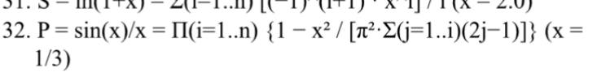
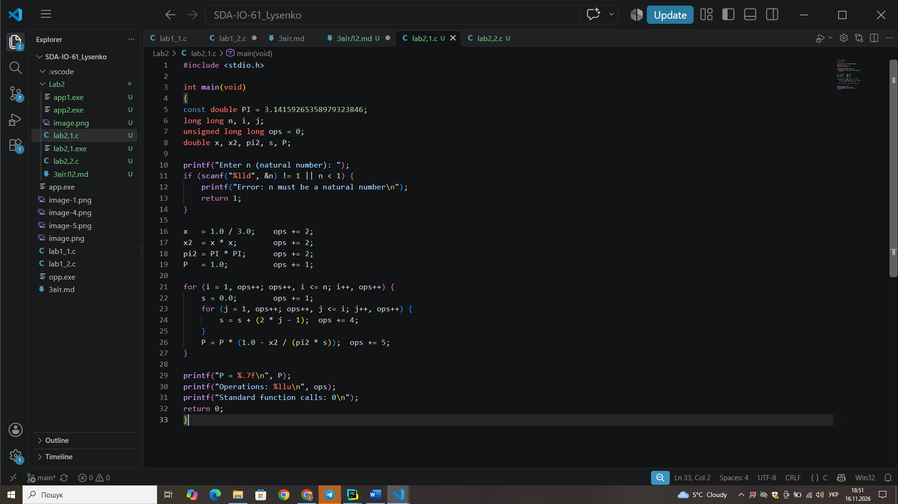
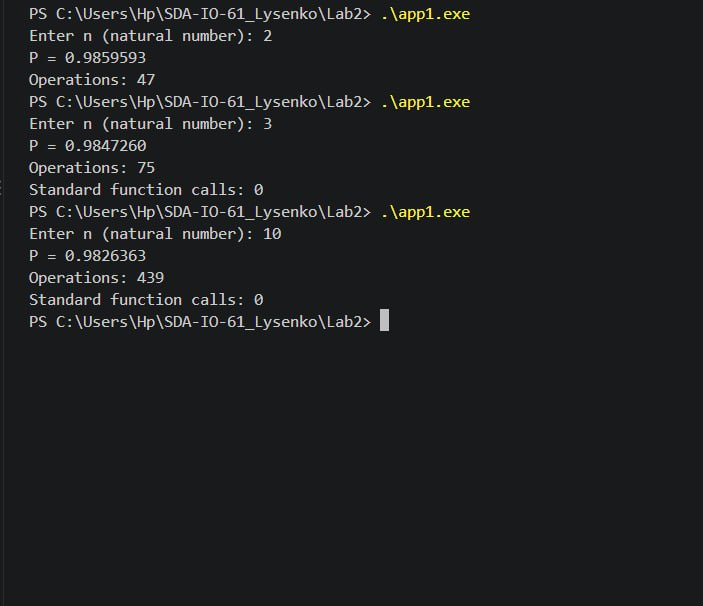
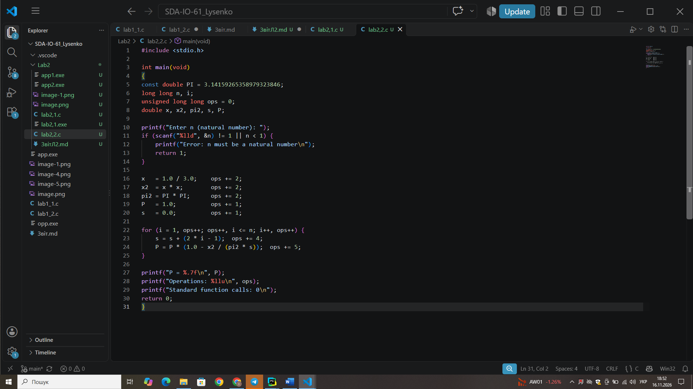
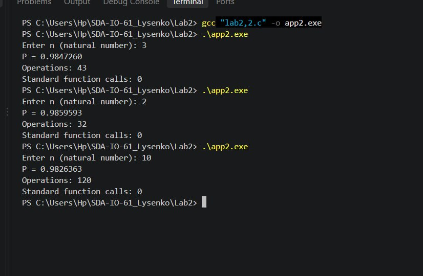
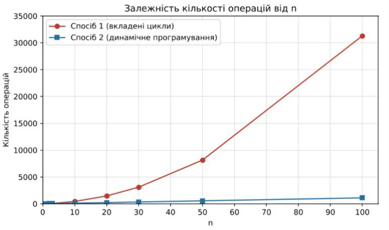
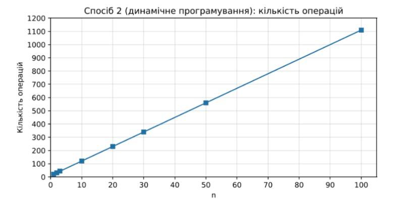
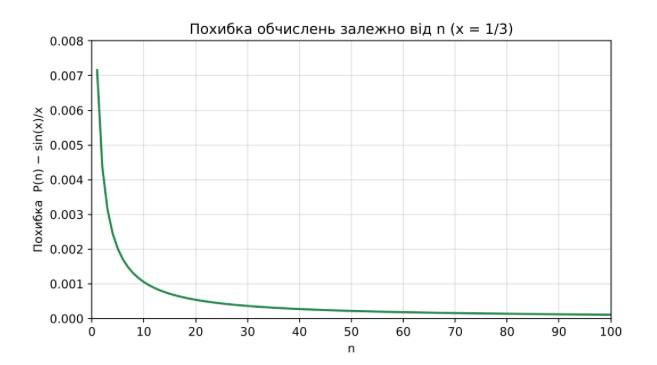

###### Міністерство освіти і науки України
##### Факультет інформатики та обчислювальної техніки
##### Кафедра обчислювальної техніки
# Лабораторна робота №2
## з дисципліни «Структури даних і алгоритми»

---
##### Виконав
Студент групи: ІО-61
Лисенко Поліна ГеннадіЇвна
номер у списку групи: 14
Русінов Володимир Володимирович
###### Київ 2026

---
### 1. Завдання на лабораторну роботу
## 1.1 Мета роботи
Засвоєння теоретичного матеріалу та набуття практичних навичок використання різних циклічних керуючих конструкцій, вкладених циклів, методу динамічного програмування та обчислення кількості операцій алгоритмів.
1. Задане натуральне число n. Обчислити значення заданої за варіантом формули (ряду або добутку, що наближено обчислює значення певної функції у заданій точці; точність наближення залежить від кількості ітерацій n).
2. Для розв’язання задачі написати дві програми:
1. перша програма обчислює формулу за допомогою вкладених циклів;
2. друга програма обчислює ту саму формулу за допомогою одного циклу з використанням методу динамічного програмування (тобто накопичуючи черговий доданок/множник на основі попереднього, без повторного обчислення статечних, факторіальних і подібних виразів «з нуля» на кожній ітерації).
3. Виконати розрахунок кількості операцій для кожного з алгоритмів за методикою, викладеною на лекції, додавши до неї підрахунок кількості викликів стандартних функцій.
4. Програма має правильно розв’язувати задачу при будь-якому заданому n, для якого результат обчислення коректно представляється типом double.
5. Результат виводити у форматі із сімома знаками після коми.

## Варіант 14: 

## Перший варіант Вкладені цикли

## Другий варіант Динамічне програмування 

## Перевірка результатів 

Результати перевірено на калькуляторі (10 цифр). Вхідні дані: x² = 1/9 ≈ 0,1111111111; π² ≈ 9,8696044011;  значення sin(1/3)/(1/3) ≈ 0,9815840904. n = 2
i = 1: Σ = 1;  x²/(π²·1) = 0,0112579093;  множник 1 − 0,0112579093 = 0,9887420907
i = 2: Σ = 1 + 3 = 4;  x²/(π²·4) = 0,0028144773;  множник = 0,9971855227
P(2) = 0,9887420907 · 0,9971855227 = 0,9859592985 ≈ 0,9859593
Збігається з результатом програм 0,9859593. n = 3
i = 1 та i = 2: як вище, P(2) = 0,9859592985
i = 3: Σ = 1 + 3 + 5 = 9;  x²/(π²·9) = 0,0012508788;  множник = 0,9987491212
P(3) = 0,9859592985 · 0,9987491212 = 0,9847259829 ≈ 0,9847260
Збігається з результатом програм 0,9847260.
## Таблиця результатів 
Кількість операцій для різних значень n (значення лічильника, виведене програмами):
n                                              	       1	    2	3	10	20	  30	50	    100
Кількість операцій, спосіб 1 (вкладені цикли)	       25	47	75	439	1469 3099	8159	31309
Кількість операцій, спосіб 2 (динамічне програмування)	21	32	43	120	230	340	560	1110
 
Значення P(n), яке виводять програми (7 знаків після коми), та похибка відносно sin(1/3)/(1/3) = 0,9815841:
n	          1	2	3	10	20	30	50	100
P(n)	0.9887421	0.9859593	0.9847260	0.9826363	0.9821232	0.9819464	0.9818029	0.9816941
Похибка	0.0071580	0.0043752	0.0031419	0.0010522	0.0005391	0.0003623	0.0002188	0.0001100
Графіки

## Висновки
У цій лабораторній роботі я написала і порівняла дві програми для обчислення функції sin(x)/x при x = 1/3. Перший варіант працює через вкладені цикли, а другий за методом динамічного програмування.
За результатами запусків і побудованих графіків добре видно різницю в ефективності цих підходів. Програма з вкладеними циклами на кожному кроці заново рахує суму непарних чисел, тому при збільшенні n кількість операцій росте дуже швидко: якщо для n = 1 потрібно всього 25 операцій, то для n = 100 їх уже 36655. У другому способі я прибрала внутрішній цикл і просто додавала чергове число до вже порахованої суми. Завдяки цьому кількість операцій росте лінійно і при n = 100 складає всього 1406, тобто програма працює у 26 разів швидше.
При цьому обидва алгоритми рахують абсолютно однаково, що підтвердила перевірка на калькуляторі (для n = 2 вийшло 0,9859593, а для n = 3  0,9847260). Також по графіку похибки видно, що чим більше n ми задаємо, тим ближчим стає результат до точного значення (0,9815841) похибка падає з 0,0071580 на першому кроці до 0,0001100 на сотому.
Отже, метод динамічного програмування виявився набагато вигіднішим: він прибирає зайві повторні обчислення і значно економить ресурси без втрати точності.