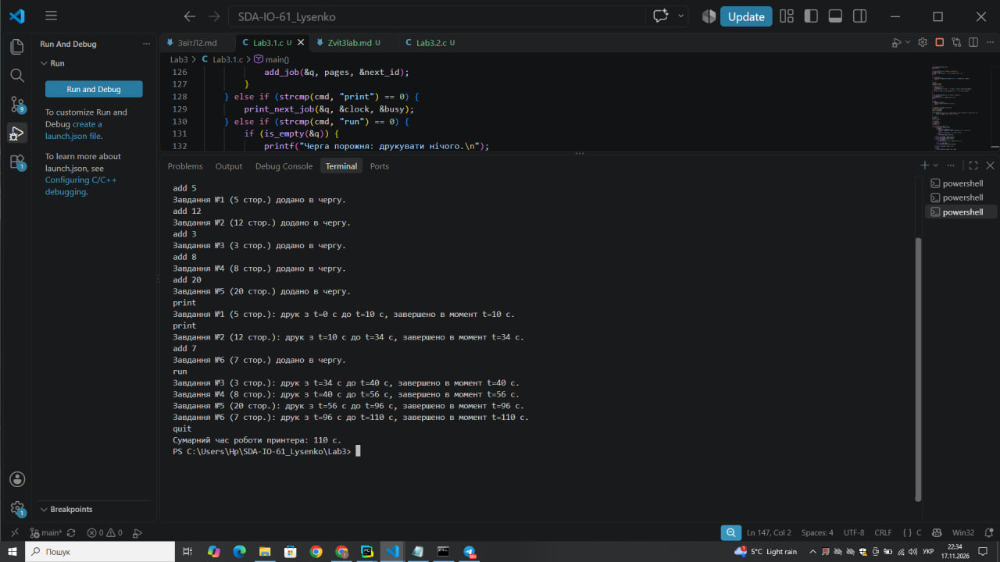
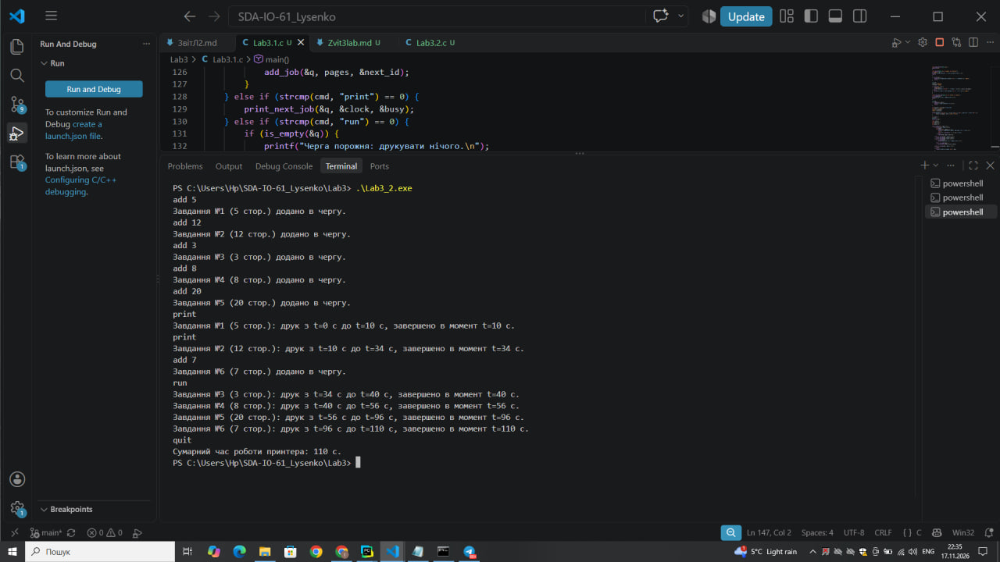
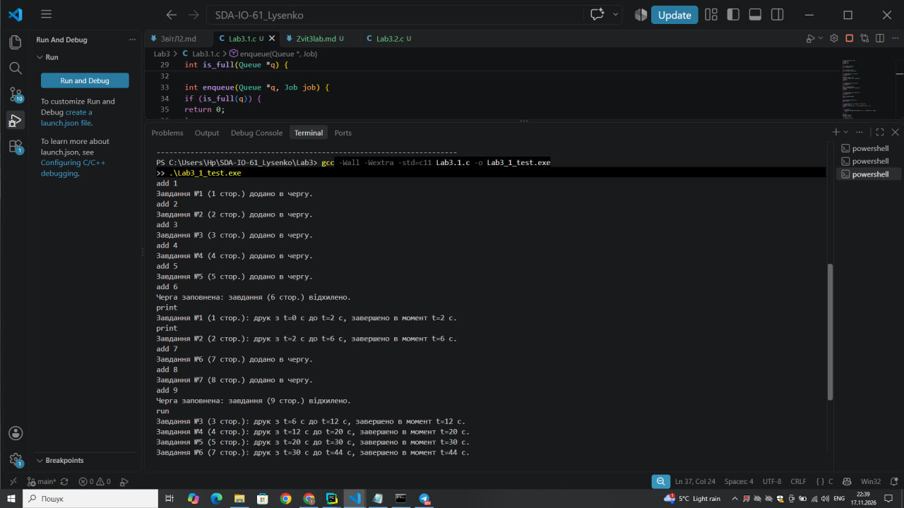
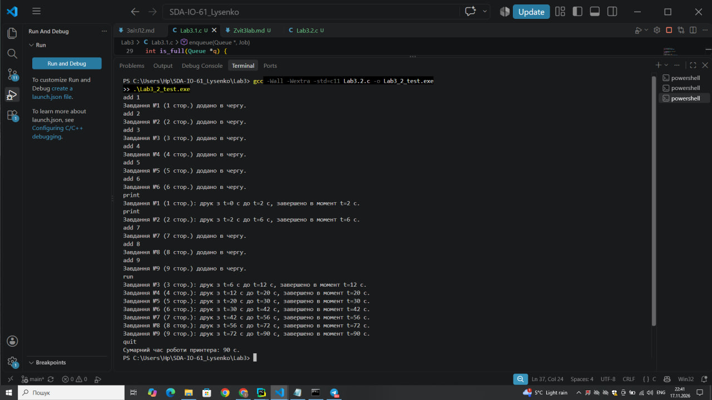

###### Міністерство освіти і науки України
##### Факультет інформатики та обчислювальної техніки
##### Кафедра обчислювальної техніки
# Лабораторна робота №3
## з дисципліни «Структури даних і алгоритми»

---
##### Виконав
Студент групи: ІО-61
Лисенко Поліна ГеннадіЇвна
номер у списку групи: 14
Русінов Володимир Володимирович
###### Київ 2026

---
### 1. Завдання на лабораторну роботу
## 1.1 Мета роботи
Засвоєння теоретичного матеріалу та набуття практичних навичок реалізації й застосування абстрактних структур даних стек (LIFO — «останнім прийшов, першим вийшов») та черга (FIFO — «першим прийшов, першим вийшов»), а також порівняння двох способів їхньої реалізації — на основі масиву фіксованого розміру та на основі однозв’язного списку.
## 2. Постановка задачі
1. Кожен варіант завдання визначає прикладну задачу (наприклад, перевірку збалансованості дужок, обчислення постфіксного виразу тощо) та структуру(и) даних, потрібну для її розв’язання (стек, чергу, або обидві).
2. Для розв’язання задачі написати дві програми, що реалізують ту саму структуру даних двома способами:
1. на основі одновимірного масиву фіксованого розміру (з окремими змінними/індексами для вершини стека або голови й хвоста черги);
2. на основі однозв’язного списку (динамічне виділення пам’яті: вузол зі значенням і вказівником на наступний вузол).
 Прикладна логіка (сама задача варіанта) в обох програмах має бути однаковою — відрізнятися має лише внутрішня реалізація стека/черги.
3. Обидві реалізації мають надавати єдиний узгоджений набір функцій, наприклад для стека: push, pop, peek, is_empty, is_full; для черги: enqueue, dequeue, peek_front, is_empty, is_full. Прикладна логіка (main і функції задачі) має викликати ці функції однаково незалежно від того, яка реалізація підключена — тобто дві програми відрізняються лише файлом/блоком, де реалізовані самі функції структури даних.
4. Розмір масиву для масивної реалізації взяти самостійно, достатнім для тестових прикладів (наприклад, 50–100 елементів), і оформити як іменовану константу.
5. Масивна реалізація черги обов’язково має бути кільцевою (циклічною): після заповнення останньої комірки масиву черга повинна продовжувати використовувати комірки, звільнені операціями dequeue, починаючи знову з початку масиву, а не вважати масив вичерпаним.
## Умови завдання
14 Чергою змоделювати обробку завдань у черзі принтера: кожне завдання має кількість сторінок (визначає тривалість друку); визначити момент завершення друку кожного завдання та сумарний час роботи принтера.
## Код
### 1 Масивна реалізація
#include <stdio.h>
#include <string.h>

#define QUEUE_SIZE 50
#define PAGE_TIME 2

typedef struct {
int id;
int pages;
} Job;

typedef struct {
Job data[QUEUE_SIZE];
int head;
int tail;
int size;
} Queue;

void queue_init(Queue *q) {
q->head = 0;
q->tail = 0;
q->size = 0;
}

int is_empty(Queue *q) {
return q->size == 0;
}

int is_full(Queue *q) {
return q->size == QUEUE_SIZE;
}

int enqueue(Queue *q, Job job) {
if (is_full(q)) {
return 0;
}
q->data[q->tail] = job;
q->tail = (q->tail + 1) % QUEUE_SIZE;
q->size++;
return 1;
}

int dequeue(Queue *q, Job *out) {
if (is_empty(q)) {
return 0;
}
*out = q->data[q->head];
q->head = (q->head + 1) % QUEUE_SIZE;
q->size--;
return 1;
}

int peek_front(Queue *q, Job *out) {
if (is_empty(q)) {
return 0;
}
*out = q->data[q->head];
return 1;
}

void queue_destroy(Queue *q) {
queue_init(q);
}

void add_job(Queue *q, int pages, int *next_id) {
if (pages <= 0) {
printf("Помилка: кількість сторінок має бути додатною.\n");
return;
}

if (is_full(q)) {
    printf("Черга заповнена: завдання (%d стор.) відхилено.\n", pages);
    return;
}

Job job;
job.id = *next_id;
job.pages = pages;

if (enqueue(q, job)) {
    (*next_id)++;
    printf("Завдання №%d (%d стор.) додано в чергу.\n", job.id, job.pages);
} else {
    printf("Не вдалося додати завдання (%d стор.) у чергу.\n", pages);
}
}

void print_next_job(Queue *q, int *clock, int *busy) {
if (is_empty(q)) {
printf("Черга порожня: друкувати нічого.\n");
return;
}

Job job;
if (!dequeue(q, &job)) {
    printf("Помилка вилучення з черги.\n");
    return;
}

int duration = job.pages * PAGE_TIME;
int start = *clock;
*clock += duration;
*busy += duration;

printf("Завдання №%d (%d стор.): друк з t=%d с до t=%d с, завершено в момент t=%d с.\n",
       job.id, job.pages, start, *clock, *clock);
}

int main() {
Queue q;
queue_init(&q);

char cmd[32];
int next_id = 1;
int clock = 0;
int busy = 0;

while (scanf("%s", cmd) == 1) {
    if (strcmp(cmd, "add") == 0) {
        int pages;
        if (scanf("%d", &pages) != 1) {
            printf("Помилка: після add потрібне ціле число сторінок.\n");
            int c;
            while ((c = getchar()) != '\n' && c != EOF);
        } else {
            add_job(&q, pages, &next_id);
        }
    } else if (strcmp(cmd, "print") == 0) {
        print_next_job(&q, &clock, &busy);
    } else if (strcmp(cmd, "run") == 0) {
        if (is_empty(&q)) {
            printf("Черга порожня: друкувати нічого.\n");
        }
        while (!is_empty(&q)) {
            print_next_job(&q, &clock, &busy);
        }
    } else if (strcmp(cmd, "quit") == 0) {
        break;
    } else {
        printf("Невідома команда: %s\n", cmd);
    }
}

printf("Сумарний час роботи принтера: %d с.\n", busy);
queue_destroy(&q);
return 0;
}
### 2 Звязочно списочна реалізація
#include <stdio.h>
#include <stdlib.h>
#include <string.h>

#define PAGE_TIME 2

typedef struct {
int id;
int pages;
} Job;

typedef struct Node {
Job job;
struct Node *next;
} Node;

typedef struct {
Node *head;
Node *tail;
int size;
} Queue;

void queue_init(Queue *q) {
q->head = NULL;
q->tail = NULL;
q->size = 0;
}

int is_empty(Queue *q) {
return q->head == NULL;
}

int is_full(Queue *q) {
if (q == NULL) {
return 1;
}
return 0;
}

int enqueue(Queue *q, Job job) {
Node *node = (Node *)malloc(sizeof(Node));
if (node == NULL) {
return 0;
}
node->job = job;
node->next = NULL;

if (q->tail == NULL) {
    q->head = node;
} else {
    q->tail->next = node;
}
q->tail = node;
q->size++;
return 1;
}

int dequeue(Queue *q, Job *out) {
if (is_empty(q)) {
return 0;
}
Node *old = q->head;
*out = old->job;
q->head = old->next;

if (q->head == NULL) {
    q->tail = NULL;
}
free(old);
q->size--;
return 1;
}

int peek_front(Queue *q, Job *out) {
if (is_empty(q)) {
return 0;
}
*out = q->head->job;
return 1;
}

void queue_destroy(Queue *q) {
Job tmp;
while (!is_empty(q)) {
dequeue(q, &tmp);
}
}

void add_job(Queue *q, int pages, int *next_id) {
if (pages <= 0) {
printf("Помилка: кількість сторінок має бути додатною.\n");
return;
}

if (is_full(q)) {
    printf("Черга заповнена: завдання (%d стор.) відхилено.\n", pages);
    return;
}

Job job;
job.id = *next_id;
job.pages = pages;

if (enqueue(q, job)) {
    (*next_id)++;
    printf("Завдання №%d (%d стор.) додано в чергу.\n", job.id, job.pages);
} else {
    printf("Не вдалося додати завдання (%d стор.) у чергу.\n", pages);
}
}

void print_next_job(Queue *q, int *clock, int *busy) {
if (is_empty(q)) {
printf("Черга порожня: друкувати нічого.\n");
return;
}

Job job;
if (!dequeue(q, &job)) {
    printf("Помилка вилучення з черги.\n");
    return;
}

int duration = job.pages * PAGE_TIME;
int start = *clock;
*clock += duration;
*busy += duration;

printf("Завдання №%d (%d стор.): друк з t=%d с до t=%d с, завершено в момент t=%d с.\n",
       job.id, job.pages, start, *clock, *clock);
}

int main() {
Queue q;
queue_init(&q);

char cmd[32];
int next_id = 1;
int clock = 0;
int busy = 0;

while (scanf("%s", cmd) == 1) {
    if (strcmp(cmd, "add") == 0) {
        int pages;
        if (scanf("%d", &pages) != 1) {
            printf("Помилка: після add потрібне ціле число сторінок.\n");
            int c;
            while ((c = getchar()) != '\n' && c != EOF);
        } else {
            add_job(&q, pages, &next_id);
        }
    } else if (strcmp(cmd, "print") == 0) {
        print_next_job(&q, &clock, &busy);
    } else if (strcmp(cmd, "run") == 0) {
        if (is_empty(&q)) {
            printf("Черга порожня: друкувати нічого.\n");
        }
        while (!is_empty(&q)) {
            print_next_job(&q, &clock, &busy);
        }
    } else if (strcmp(cmd, "quit") == 0) {
        break;
    } else {
        printf("Невідома команда: %s\n", cmd);
    }
}

printf("Сумарний час роботи принтера: %d с.\n", busy);
queue_destroy(&q);
return 0;
}
## Результати 
Звичайний випадок роботи
1
2
Операція на порожній черзі
1
2
Переповнення заповненого масиву 
1
2
## Висновки
Під час лабораторної роботи я реалізувала чергу друку (FIFO) двома способами: на основі статичного кільцевого масиву (розміром 50 елементів) та на основі однозв’язного списку.
Порівняння реалізацій:
Масивний варіант одразу виділяє фіксовану пам’ять на стеку і не дозволяє додати понад 50 завдань. Списковий варіант працює через динамічну пам’ять  витрачає трохи більше місця на вказівники , але не має жорсткого ліміту на кількість елементів.
 Додавання (enqueue) і видалення (dequeue) в обох програмах працюють за сталий час. Різниця є лише при знищенні черги у масиві це миттєве обнулення змінних за , а у списку прохід по всіх вузлах із викликом.
 На звичайних прикладах обидві програми однаково точно рахують час виконання кожного завдання (по 2 секунди на сторінку) та загальну зайнятість принтера. Кільцевий буфер коректно перезаписує звільнені комірки після команди print.
 При спробі виконати print або run на порожній черзі програми не падають з помилкою, а виводять повідомлення «Черга порожня друкувати нічого».
 При додаванні 51-го завдання в масивну чергу спрацьовує перевірка is_full: виходу за межі масиву не відбувається, програма просто відхиляє заявку. У списку такого обмеження немає.
Кільцевий масив зручніший, коли заздалегідь відомий максимальний розмір черги і важлива швидкість без зайвих звернень до динамічної пам’яті. Зв’язний список варто брати тоді, коли кількість завдань непередбачувана і не можна втрачати дані через переповнення буфера.