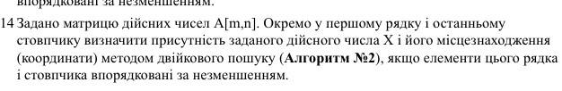
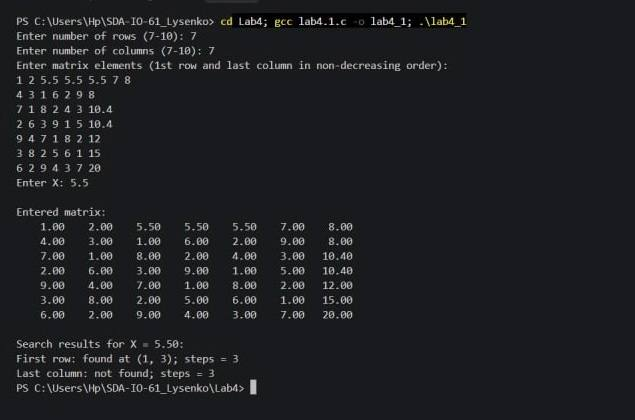
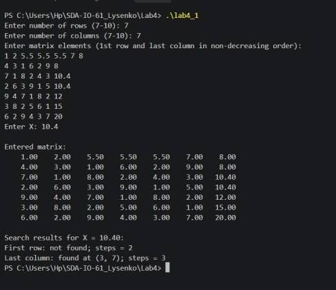
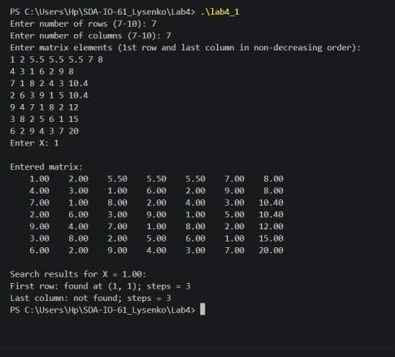
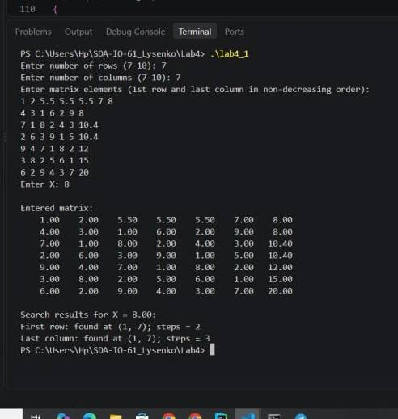
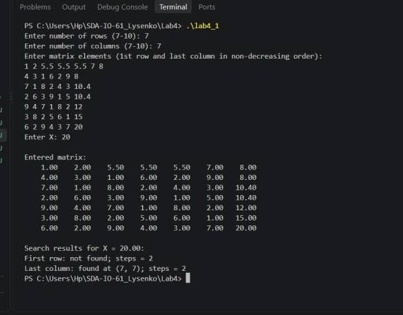
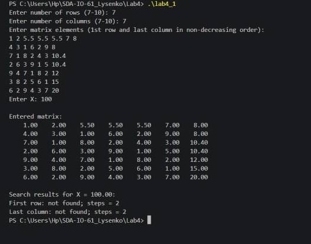
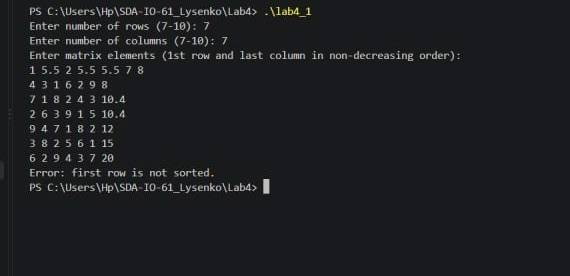

###### Міністерство освіти і науки України
##### Факультет інформатики та обчислювальної техніки
##### Кафедра обчислювальної техніки
# Лабораторна робота №4
## з дисципліни «Структури даних і алгоритми»

---
##### Виконав
Студент групи: ІО-61
Лисенко Поліна ГеннадіЇвна
номер у списку групи: 14
Русінов Володимир Володимирович
###### Київ 2026

---
### 1. Завдання на лабораторну роботу
## 1.1 Мета роботи
Засвоєння теоретичного матеріалу та набуття практичних навичок розв’язання задачі пошуку заданої категорії елементів за допомогою різних алгоритмів методу двійкового пошуку у двовимірних масивах.
2. Постановка задачі
1. Написати програму розв’язання задачі пошуку (за варіантом) у двовимірному масиві (матриці) методом двійкового пошуку. Конкретний алгоритм двійкового пошуку (№1 або №2) задається варіантом завдання.
2. Розміри матриці m та n взяти самостійно в межах від 7 до 10.
3. При тестуванні програми підбирати такі вхідні набори значень матриці, щоб можна було легко відстежити коректність виконання пошуку, і щоб ця коректність була протестована для всіх можливих випадків. З метою тестування дозволяється використовувати матриці меншого розміру.
## Варіант завдання 14

Код завдання
#include <stdio.h>

#define MAX 10
#define EPS 0.000001

int equal(double a, double b)
{
if (a - b < EPS && b - a < EPS)
return 1;
else
return 0;
}

int main()
{
double A[MAX][MAX];
double x;
int m, n;
int i, j;

printf("Enter number of rows (7-10): ");
scanf("%d", &m);
printf("Enter number of columns (7-10): ");
scanf("%d", &n);

if (m < 7 || m > 10 || n < 7 || n > 10)
{
    printf("Error: matrix size must be from 7 to 10.\n");
    return 1;
}

printf("Enter matrix elements (1st row and last column in non-decreasing order):\n");
for (i = 0; i < m; i++)
{
    for (j = 0; j < n; j++)
    {
        scanf("%lf", &A[i][j]);
    }
}

for (j = 1; j < n; j++)
{
    if (A[0][j] < A[0][j - 1] - EPS)
    {
        printf("Error: first row is not sorted.\n");
        return 1;
    }
}

for (i = 1; i < m; i++)
{
    if (A[i][n - 1] < A[i - 1][n - 1] - EPS)
    {
        printf("Error: last column is not sorted.\n");
        return 1;
    }
}

printf("Enter X: ");
scanf("%lf", &x);

printf("\nEntered matrix:\n");
for (i = 0; i < m; i++)
{
    for (j = 0; j < n; j++)
    {
        printf("%8.2lf", A[i][j]);
    }
    printf("\n");
}

printf("\nSearch results for X = %.2lf:\n", x);

int left = 0;
int right = n - 1;
int steps_row = 0;

while (left < right)
{
    int middle = (left + right) / 2;
    steps_row++;
    if (A[0][middle] < x - EPS)
    {
        left = middle + 1;
    }
    else
    {
        right = middle;
    }
}

if (equal(A[0][left], x))
{
    printf("First row: found at (1, %d); steps = %d\n", left + 1, steps_row);
}
else
{
    printf("First row: not found; steps = %d\n", steps_row);
}

// 2. Пошук в останньому стовпчику
left = 0;
right = m - 1;
int steps_col = 0;

while (left < right)
{
    int middle = (left + right) / 2;
    steps_col++;
    if (A[middle][n - 1] < x - EPS)
    {
        left = middle + 1;
    }
    else
    {
        right = middle;
    }
}

if (equal(A[left][n - 1], x))
{
    printf("Last column: found at (%d, %d); steps = %d\n", left + 1, n, steps_col);
}
else
{
    printf("Last column: not found; steps = %d\n", steps_col);
}

return 0;
}
## Перевірка а тестування
Для основного тестування обрано розмір матриці m = 7, n = 7. Перший рядок та останній стовпчик впорядковані за незменшенням і містять випадки розташування шуканого дійсного числа на початку, посередині та в кінці, повторення числа підряд, а також його відсутності
| № | 1 | 2 | 3 | 4 | 5 | 6 | 7 |
| :---: | :---: | :---: | :---: | :---: | :---: | :---: | :---: |
| **1** | **1** | **2** | **5.5** | **5.5** | **5.5** | **7** | **8** |
| **2** | 4 | 3 | 1 | 6 | 2 | 9 | **8** |
| **3** | 7 | 1 | 8 | 2 | 4 | 3 | **10.4** |
| **4** | 2 | 6 | 3 | 9 | 1 | 5 | **10.4** |
| **5** | 9 | 4 | 7 | 1 | 8 | 2 | **12** |
| **6** | 3 | 8 | 2 | 5 | 6 | 1 | **15** |
| **7** | 6 | 2 | 9 | 4 | 3 | 7 | **20**| 
При х=5.5
Пошук по середині повторенням у першому рядку

При х=10.4
Пошук по середині з повторенням в отанньому стовпчику 

При х=1 
Пошук крайнього лівого елемента на початку першого рядка

При х=8
Пошук крайнього правого ел першого рядка

При х=20
Пошук крайнього елеемента в кінці останнього стовпчика 

При х=100
Шукане число відсутнє

Перевірка захисту вд несортованого рядка

## Висновки
Висновок: У ході лабораторної роботи було написано програму для пошуку дійсного числа X окремо у першому рядку та останньому стовпчику матриці методом двійкового пошуку (Алгоритм №2).
На тестовій матриці 7 × 7 програма правильно відпрацювала всі випадки: при X = 5.5 знайшла найлівіше входження серед трьох повторюваних чисел у першому рядку — позицію (1, 3), а при X = 10.4 — найперше входження в останньому стовпчику на позиції (3, 7). Крайні елементи ліворуч і праворуч теж визначилися без помилок: при X = 1 знайдено (1, 1), при X = 8 знайдено (1, 7) і в першому рядку, і в останньому стовпчику, а при X = 20 позицію (7, 7). При X = 100 програма повідомила, що числа немає, а при порушенні порядку вводу вивела повідомлення про помилку сортування. На відміну від Алгоритму №1, який зупиняється на першому-ліпшому збігу, Алгоритм №2 завжди знаходить крайній лівий елемент серед однакових.
Залежно від позиції шуканого елемента двійковий пошук робив по 2–3 кроки для рядка і стовпчика (разом 4–6 порівнянь). Для порівняння, лінійному пошуку на цих же даних при X = 5.5 знадобилося б 10 переглядів (проти 6 у двійкового), а при X = 20 та X = 100 14 переглядів (проти 4 у двійкового). Отже, двійковий пошук працює без помилок і потребує значно менше перевірок за лінійний.

