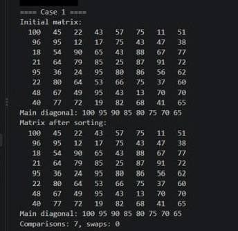
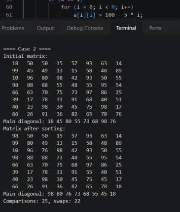
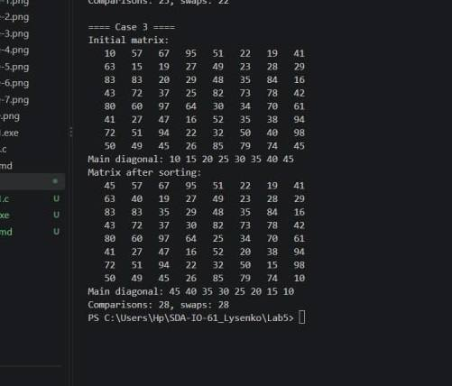

###### Міністерство освіти і науки України
##### Факультет інформатики та обчислювальної техніки
##### Кафедра обчислювальної техніки
# Лабораторна робота №5
## з дисципліни «Структури даних і алгоритми»

---
##### Виконав
Студент групи: ІО-61
Лисенко Поліна ГеннадіЇвна
номер у списку групи: 14
Русінов Володимир Володимирович
###### Київ 2026

---
### 1. Завдання на лабораторну роботу
## 1.1 Мета роботи
Засвоєння теоретичного матеріалу та набуття практичних навичок розв’язання задачі сортування заданої категорії елементів за допомогою різних алгоритмів сортування у двовимірних масивах.
2. Завдання 
Задано двовимірний масив (матрицю) цілих чисел A[m,n] або A[n,n], де m та n — натуральні числа (константи), що визначають розміри масиву. Виконати сортування цього масиву або заданої за варіантом його частини у заданому порядку заданим алгоритмом. Сортування повинно виконуватися безпосередньо у двовимірному масиві «на тому ж місці», без перезаписування масиву чи його частини до інших одно- чи двовимірних масивів та без використання спискових структур даних. Розміри матриці беруться самостійно в межах від 7 до 10.
## Завдання варіанта 14
Задано квадратний двовимірний масив (матрицю) цілих чисел A[n,n]. Відсортувати головну діагональ масиву алгоритмом №4 методу обмінів («шейкерне сортування») за незбільшенням. Розмір матриці: n = 8.
## Код 
#include <stdio.h>
#include <stdlib.h>
#define N 8
int cmp, swp;
void shaker_sort(int a[N][N])
{
    int left = 0, right = N - 1, last, i, t;
    cmp = 0;
    swp = 0;
    while (left < right) {
        last = left;
        for (i = left; i < right; i++) {
            cmp++;
            if (a[i][i] < a[i + 1][i + 1]) {
                t = a[i][i];
                a[i][i] = a[i + 1][i + 1];
                a[i + 1][i + 1] = t;
                swp++;
                last = i;
            }
        }
        right = last;
        last = right;
        for (i = right; i > left; i = i - 1) {
            cmp++;
            if (a[i - 1][i - 1] < a[i][i]) {
                t = a[i - 1][i - 1];
                a[i - 1][i - 1] = a[i][i];
                a[i][i] = t;
                swp++;
                last = i;
            }
        }
        left = last;
    }
}
void print_matrix(int a[N][N])
{
    int i, j;
    for (i = 0; i < N; i++) {
        for (j = 0; j < N; j++)
            printf("%5d", a[i][j]);
        printf("\n");
    }
    printf("Main diagonal: ");
    for (i = 0; i < N; i++)
        printf("%d ", a[i][i]);
    printf("\n");
}
int main(void)
{
    int a[N][N], i, j, k;
    srand(14);
    for (k = 1; k <= 3; k++) {
        printf("\n==== Case %d ====\n", k);
        for (i = 0; i < N; i++)
            for (j = 0; j < N; j++)
                a[i][j] = rand() % 90 + 10;
        if (k == 1)
            for (i = 0; i < N; i++)
                a[i][i] = 100 - 5 * i;
        if (k == 3)
            for (i = 0; i < N; i++)
                a[i][i] = 10 + 5 * i;
        printf("Initial matrix:\n");
        print_matrix(a);
        shaker_sort(a);
        printf("Matrix after sorting:\n");
        print_matrix(a);
        printf("Comparisons: %d, swaps: %d\n", cmp, swp);
    }
    return 0;
}
## Тестування 
Для кожного з трьох початкових станів головної діагоналі виводяться матриця до і після сортування. Елементи поза головною діагоналлю заповнені випадковими числами та після сортування залишаються на своїх місцях.
Випадок 1: головна діагональ уже відсортована 

Випадок 2: головна діагональ заповнена випадковими числами

Випадок 3: головна діагональ уже відсортована обернено на зменшення

Результати 
Зведені результати тестування
Початковий стан діагоналі Порівнянь Обмінів
Відсортований           7 0
Випадковий             25 22
Обернено відсортований 28 28
## Висновки
Під час виконання лабораторної роботи було реалізовано програму для сортування головної діагоналі квадратної матриці 8 на 8 за незбільшенням «на місці» алгоритмом №4 методу обмінів (шейкерне сортування із запам’ятовуванням місця останньої перестановки).
Експериментальне тестування на трьох початкових станах діагоналі показало такі результати:
Уже відсортована діагональ (100 95 90 85 80 75 70 65) алгоритм спрацював найшвидше, виконавши 7 порівнянь і 0 обмінів, оскільки під час першого проходу перестановок не відбулося, і межі пошуку одразу зійшлися.
Випадкова послідовність (18 45 80 55 73 68 98 76): виконано 25 порівнянь та 22 обміни, де рух в обидва боки та фіксація останньої перестановки дозволили відсікти вже впорядковані ділянки на краях.
Обернено відсортована діагональ (10 15 20 25 30 35 40 45): алгоритм спрацював найповільніше, виконавши 28 порівнянь та 28 обмінів, адже кожен елемент стояв у зворотному порядку, кожне порівняння призводило до обміну, а межі зсувалися лише на одну позицію за прохід.
Отримані дані повністю відповідають теоретичній складності шейкерного сортування: лінійній O(n) у найкращому випадку (N - 1 = 7 порівнянь) та квадратичній O(n^2) у середньому й найгіршому випадках (максимум $N(N - 1) / 2 = 28$  порівнянь і перестановок).