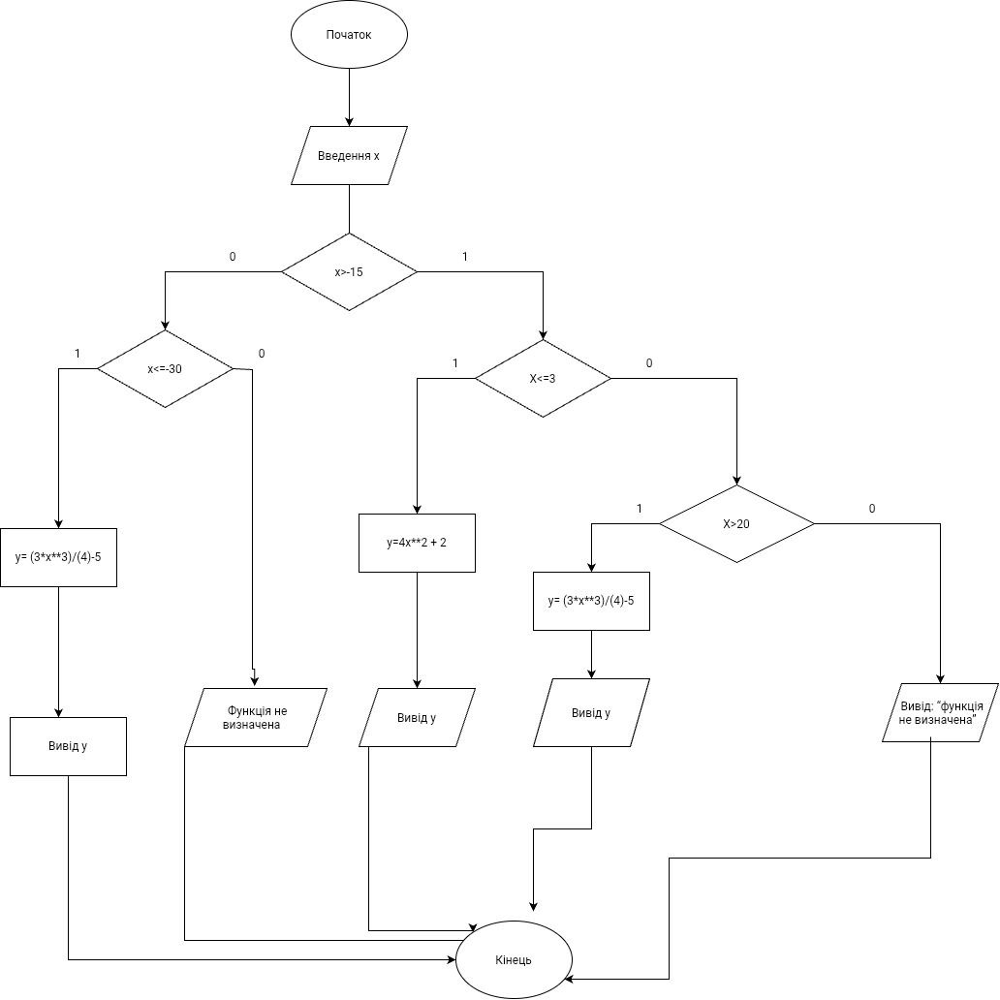
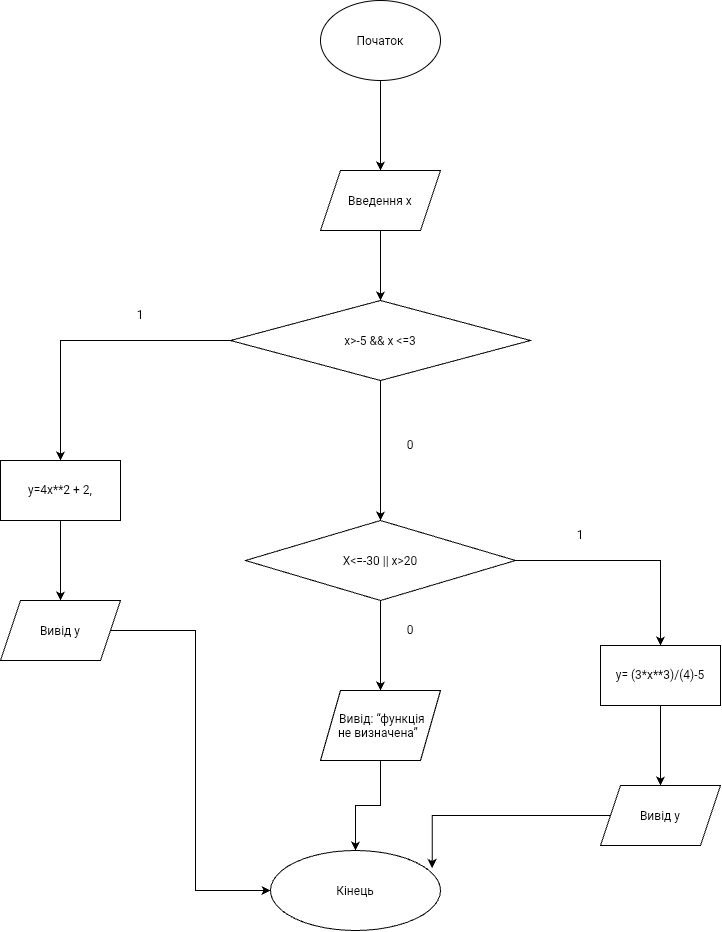
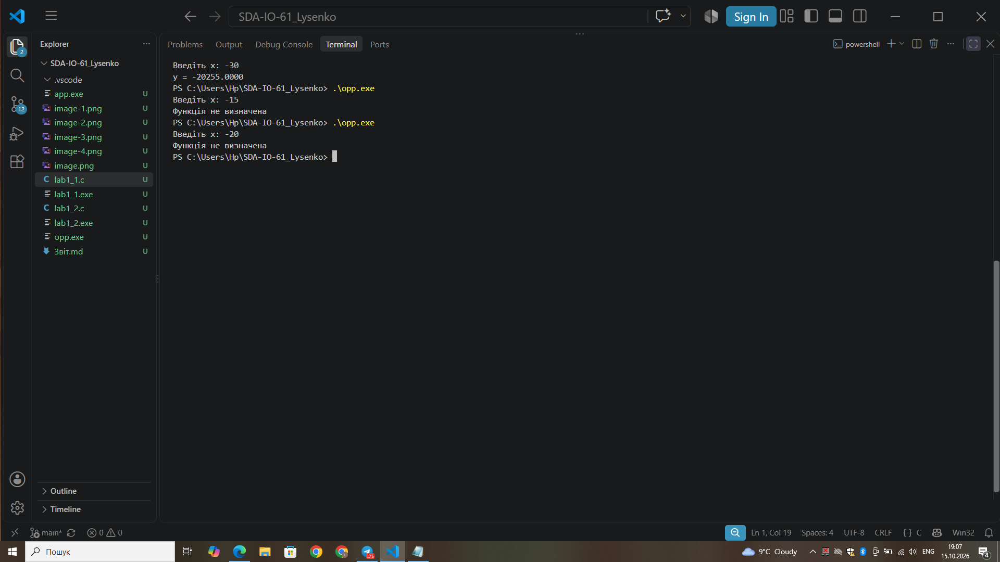
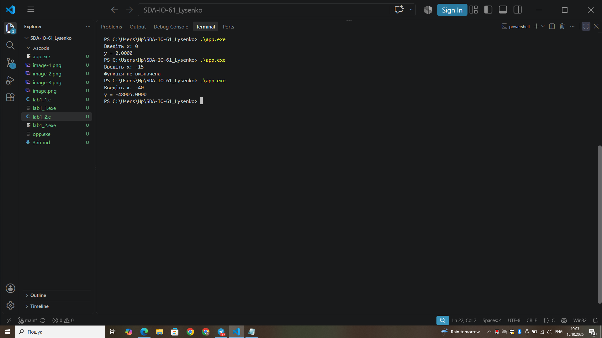

###### Міністерство освіти і науки України
##### Факультет інформатики та обчислювальної техніки
##### Кафедра обчислювальної техніки
# Лабораторна робота №1
## з дисципліни «Структури даних і алгоритми»

---
##### Виконав
Студент групи: ІО-61
Лисенко Поліна ГеннадіЇвна
номер у списку групи: 14
Русінов Володимир Володимирович
###### Київ 2026

---
## Завдання
Задано дійсне число x. Визначити значення заданої за варіантом кусково-неперервної функції y(x), якщо воно існує, або вивести на екран повідомлення про неіснування функції для заданого x.

Розв'язати задачу двома способами (написати дві програми):

1. У програмі дозволяється використовувати тільки одиничні операції порівняння (`=`, <>, <, <=, >, >=`) і **не дозволяється** використовувати булеві (логічні) операції (`not, and, or тощо);
2. У програмі необхідно обов'язково використати булеві (логічні) операції (`not`, and, or тощо); використання булевих операцій не повинно бути надлишковим.

###### Умови до варіанту 14:
[15.10.2026 18:27] Polinymka: Задано дійсне число x. Визначити значення заданої за варіантом кусково-неперервної функції y(x), якщо воно існує, або вивести на екран повідомлення про неіснування функції для заданого x.

Розв'язати задачу двома способами (написати дві програми):

1. У програмі дозволяється використовувати тільки одиничні операції порівняння (`=`, <>, <, <=, >, >=`) і **не дозволяється** використовувати булеві (логічні) операції (`not, and, or тощо);
2. У програмі необхідно обов'язково використати булеві (логічні) операції (`not`, and, or тощо); використання булевих операцій не повинно бути надлишковим.

###### Умови до варіанту 1:
Для заданого дійсного x обчислити:
y(x) =    f1(x) ,  x ∈ D1
          f2(x) ,  x ∈ D2
          Варіант f1(x), x ∈ D1 f2(x), x ∈ D2
4, 14, 24 4x² + 2, x ∈ (-15, 3] 3x³/4 - 5, x ∈ (-∞, -30] ∪ (20, +∞)
Блок схеми 
 спосіб1
 спосіб 2
## Програмний код програми 
#### Перший спосіб 
#include <stdio.h>

int main(void)
{
    double x;
    double y;

    printf("Введіть x: ");
    scanf("%lf", &x);

    if (x > -15) {
        if (x <= 3) {
            y = 4 * x * x + 2;
            printf("y = %.4f\n", y);
        } else {
            if (x > 20) {
                y = 3 * x * x * x / 4 - 5;
                printf("y = %.4f\n", y);
            } else {
                printf("Функція не визначена\n");
            }
        }
    } else {
        if (x <= -30) {
            y = 3 * x * x * x / 4 - 5;
            printf("y = %.4f\n", y);
        } else {
            printf("Функція не визначена\n");
        }
    }

    return 0;
}
#### Другий спосіб
#include <stdio.h>

int main(void)
{
    double x;
    double y;

    printf("Введіть x: ");
    scanf("%lf", &x);

    if (x > -15 && x <= 3) {
        y = 4 * x * x + 2;
        printf("y = %.4f\n", y);
    } else if (x <= -30 || x > 20) {
        y = 3 * x * x * x / 4 - 5;
        printf("y = %.4f\n", y);
    } else {
        printf("Функція не визначена\n");
    }

    return 0;
}
---

## Тест кожноі програми
І очікувані результати 
| x | Очікуваний результат |
| :--- | :--- |
| **-40** | -48005.0000 |
| **-30** | -20255.0000 |
| **-20** | не визначена |
| **-15** | не визначена (межа не входить) |
| **-10** | 402.0000 |
| **0** | 2.0000 |
| **3** | 38.0000 |
| **20** | не визначена (межа не входить) |
| **21** | 6940.7500 |

---

##### Результати тестів
Перший спосіб 

Другий спосіб
